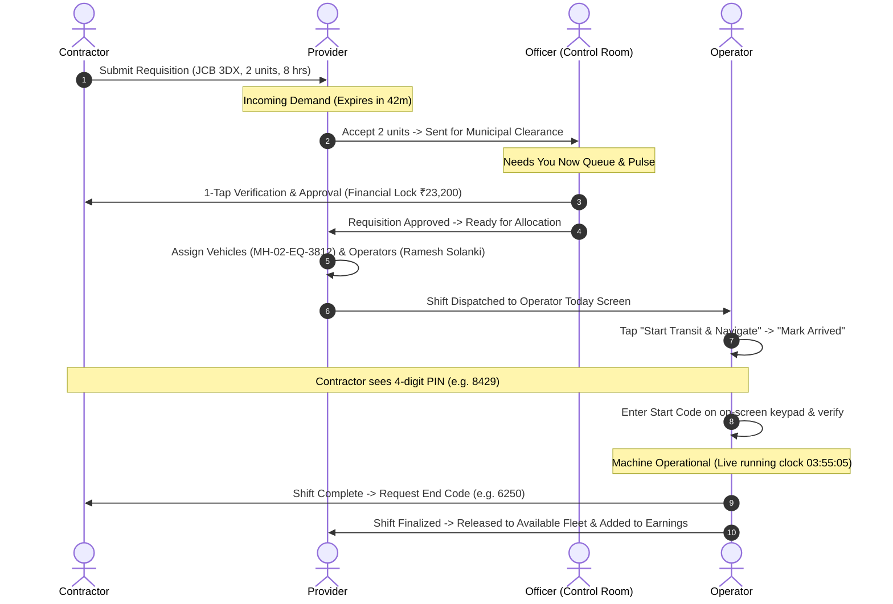

# Equip Me – Unified Four-Domain Heavy Machinery Application

A modern, production-grade operational application built for civil heavy machinery logistics and municipal public works (Brihanmumbai Municipal Corporation / BMC pool). The platform seamlessly unifies all four operational stakeholders into one interconnected ecosystem:

1. **Contractor Domain** (`/contractor`): Equipment requisition, 3-step booking wizard with interactive map pin drop and reverse geocoding, live machine tracking, arrival PIN handoff, dispute escalation.
2. **Provider Domain** (`/provider`): Incoming demand triage, full/partial acceptance, vehicle & operator unit assignment, daily fleet schedule, base depot & municipal coverage map, equipment management, revenue & payout tracking.
3. **Operator Domain** (`/operator`): Shift dispatch, transit & arrival confirmation, turn-by-turn route navigation map, 4-digit PIN verification keypad, live shift workbench with ticking clock, end-code completion.
4. **Officer Domain** (`/officer`): Control room executive dashboard with 1-Tap quick approvals, all ward bookings triage, multi-point verification checklist, live GPS corridor telematics map, registered provider & contractor directory with masked calls, incident resolution, and CSV reports.

---

## 1. Project Architecture

The codebase strictly separates the user interface and the business logic into two standalone directories:

```text
build_unified_four_domain_experience/
│
├── frontend/                     # React.js SPA Application
│   ├── public/                   # Favicons, machine fallbacks, SVGs
│   ├── src/
│   │   ├── components/           # DomainSwitcher, BottomNav, StatusBadge, Modal
│   │   ├── layouts/              # AppShell (mobile-first container)
│   │   ├── domains/
│   │   │   ├── contractor/       # Home, Catalogue, 3-Step Wizard, Bookings, LiveBooking, Profile
│   │   │   ├── provider/         # Requests, Assign, Schedule, Fleet, EquipmentEdit, Profile
│   │   │   ├── operator/         # Today, StartCode (Keypad), LiveShift (Clock), History, Profile
│   │   │   └── officer/          # Dashboard (Pulse), Requests, Verification, Directory, More
│   │   ├── services/             # REST API Client (api.js)
│   │   ├── styles/               # Tailwind CSS & Noto Sans typography
│   │   ├── App.jsx               # Unified domain coordinator & router
│   │   └── main.jsx
│   ├── package.json
│   ├── tailwind.config.js
│   └── vite.config.js
│
├── backend/                      # Python FastAPI Application
│   ├── app/
│   │   ├── api/                  # Domain routers (contractor, provider, operator, officer, shared)
│   │   ├── core/                 # Config & CORS settings
│   │   ├── database/             # In-memory thread-safe state store & fixtures
│   │   ├── schemas/              # Pydantic request & response models
│   │   ├── services/             # Business logic, status machines, PIN generation, audits
│   │   └── main.py               # FastAPI application entrypoint
│   ├── tests/                    # Integration & end-to-end lifecycle test suite
│   ├── requirements.txt
│   └── .env.example
│
└── README.md
```

---

## 2. Design System & Minimal UI Reference Matching

The interface accurately replicates the **Site Yellow** visual language specified in the Google Stitch design reference and the 4 uploaded minimal UI screenshots:

- **Primary Amber (`#FFB400`)**: Full-width 56px action buttons, active indicator dots, and primary accents.
- **Charcoal Typography (`#1C1C1E`)**: High-density ink for direct outdoor readability under bright sunlight (never white text on yellow).
- **Surfaces & Cards (`#FFFFFF`, `#F5F5F7`, `#F8F9FA`)**: Clean containment with subtle 1px `#E5E7EB` borders and gentle ambient depth.
- **Display Code Typography**: Dedicated 4-digit boxes for verbally confirming arrival and handover PIN tokens (`8 4 2 9` / `5 8 2 1`).
- **Mobile-First App Shell**: Persistent bottom dock navigation, tactile counters, single-thumb ergonomic touch targets, and sticky action footers.
- **Equip Me Workspace Chooser**: Clean role selection screen (Contractor, Provider, Operator, Officer) with dynamic identity previews and 1-click workspace entry.
- **Interactive Map Engine**: Integrated Leaflet with CartoDB Voyager tiles, satellite imagery toggle, draggable Site Yellow pin, OpenStreetMap Nominatim reverse geocoding, depot coverage circles, and GPS route corridors.

---

## 3. End-to-End Interconnected Workflow

Changes made in any domain immediately propagate to connected workflows:



---

## 4. How to Run the Unified Application

### Prerequisites
- **Python**: 3.10+ (tested on Python 3.13)
- **Node.js**: 18+ (tested on Node v22)

### Single-Command Unified Run (Frontend + Backend on One Port)

1. Install backend requirements and build the frontend:
   ```bash
   pip install -r requirements.txt
   npm run build
   ```
2. Start the unified application:
   ```bash
   python main.py
   ```
   Or using npm:
   ```bash
   npm start
   ```
3. Open your browser:
   - **Unified Application & UI**: [http://localhost:8000](http://localhost:8000)
   - **Swagger API Docs**: [http://localhost:8000/docs](http://localhost:8000/docs)
   - **API Health**: [http://localhost:8000/api/health](http://localhost:8000/api/health)

---

### Development Mode (with Live Hot Module Reloading)

If you are developing frontend components with live HMR:

1. In Terminal 1 (Backend API):
   ```bash
   python main.py
   ```
2. In Terminal 2 (Frontend with Vite Proxy):
   ```bash
   npm run dev:frontend
   ```
   Open [http://localhost:5173](http://localhost:5173). The Vite dev server automatically proxies all `/api/*` requests to `:8000`.

---

## 5. Running Automated Tests

Run the full unified test suite verifying frontend serving, static assets, and complete 4-domain lifecycle:

```bash
pytest
```
Or:
```bash
npm run test:backend
```

Expected output:
```text
backend\tests\test_api_integration.py .......                            [100%]
7 passed in 1.66s
```

---

## 6. Demo Features & Controls

- **Top Domain Switcher**: Switch anytime between Contractor, Provider, Operator, and Officer.
- **Reset Button**: Tap the "Reset" button on the top right at any time to restore all demo data back to default fixtures.
- **CSV Export**: In Officer -> More, tap "Export All Ward Requisitions Report (CSV)" to download a full municipal report.
- **Incident Escalation**: Report breakdowns from Contractor or Operator, and immediately resolve or reassign them in Officer Console.
